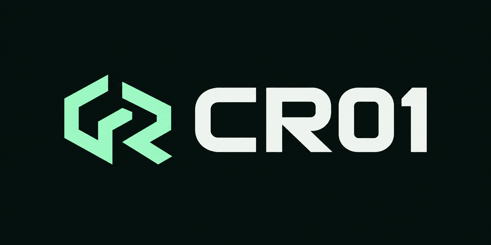

# CR01-SC

A session-protocol research prototype with a C++ engine, Python wrapper,
reference tests and a local visual demo. Build the native engine from source.

Release 0.15.2 · protocol v2.

> **Not production-ready. Do not use CR01-SC to protect real secrets.**
> There is no side-channel assurance; constant-time behavior has not been
> established. Tests and benchmarks are not a security proof.



## Try it

Install Python 3.11 or later and the native
[build prerequisites](docs/GUIDE.md#build-and-test-c). Run from this folder.

Windows (PowerShell):

```powershell
python -m venv .venv
.\.venv\Scripts\python.exe -m pip install -r requirements.lock
.\.venv\Scripts\python.exe -m pip install --no-deps -e .
powershell -ExecutionPolicy Bypass -File tools/build_native.ps1
.\.venv\Scripts\python.exe -m cr01_sc.app --open
```

Linux (Bash):

```bash
python3 -m venv .venv
.venv/bin/python -m pip install -r requirements.lock
.venv/bin/python -m pip install --no-deps -e .
bash tools/build_native.sh
.venv/bin/python -m cr01_sc.app --open
```

Both scripts are included: [Windows](tools/build_native.ps1) and
[Linux](tools/build_native.sh). Use patched OpenSSL development files with
ML-KEM/ML-DSA support; this preview was tested with 3.6.5. Older system OpenSSL
is insufficient. Custom Windows/Linux prefixes use `OPENSSL_ROOT`; see the guide.

The browser opens a local Evidence Console. You can inspect supplied results
and run 13 native checks. Live identities, handshake and records use the C++
engine through the Python binary wrapper. There is no Python protocol fallback;
a missing or failed engine produces a clear error. The UI does not build or
benchmark the engine automatically.

If the browser does not open, visit `http://127.0.0.1:8765/`.
Stop the server with Ctrl+C.

The [guide](docs/GUIDE.md) covers native peers, temporary identity files and the
Python reference implementation used for tests.

Native evaluation requires locked-memory capacity and private identity-file
permissions; unsupported protection settings fail explicitly. Live VM/process
snapshot restoration is unsupported. See the [host prerequisites](docs/GUIDE.md#memory-and-identity-prerequisites)
and [rollback policy](docs/PROTOCOL.md#rollback-policy). These controls do not
establish process-wide secure memory or change the research-only security limits.

## Read next

[Handshake one-pager](docs/HANDSHAKE.pdf): algorithms, four messages and protected records.

| File | What it answers |
| --- | --- |
| [Guide](docs/GUIDE.md) | How do I run the demo, build C++ and connect two peers? |
| [Results](docs/RESULTS.md) | What passed, how fast was it, and what remains unproven? |
| [Protocol](docs/PROTOCOL.md) | What does v2 authenticate, and where are its limits? |
| [Validation](docs/VALIDATION.md) | How do I repeat the checks or verify this bundle? |

## Folder map

```text
src/cpp/        C++ engine and native app sources
src/python/     Installable cr01_sc wrapper, reference and visual demo
bin/            Generated executable and Windows DLLs (not shipped)
config/         Native dependency locks
tests/          protocol, native, app, benchmarks and release checks
tools/          Validation, benchmark and packaging commands
docs/           The four guides above
reports/        Eight current receipts/fixtures; benchmarks grouped together
```

## Licence and security reports

Source-Available for Noncommercial & Research Use under
[PolyForm Noncommercial 1.0.0](LICENSE). Commercial use is not granted.
No separate commercial licence is offered or promised here. The exact licence
terms control; dependencies keep their own [licences](THIRD_PARTY_NOTICES.md).

Report suspected vulnerabilities privately to
[cr01@smart-fox-innovation.com](mailto:cr01@smart-fox-innovation.com).
Read [SECURITY.md](SECURITY.md) before posting security-sensitive details.
